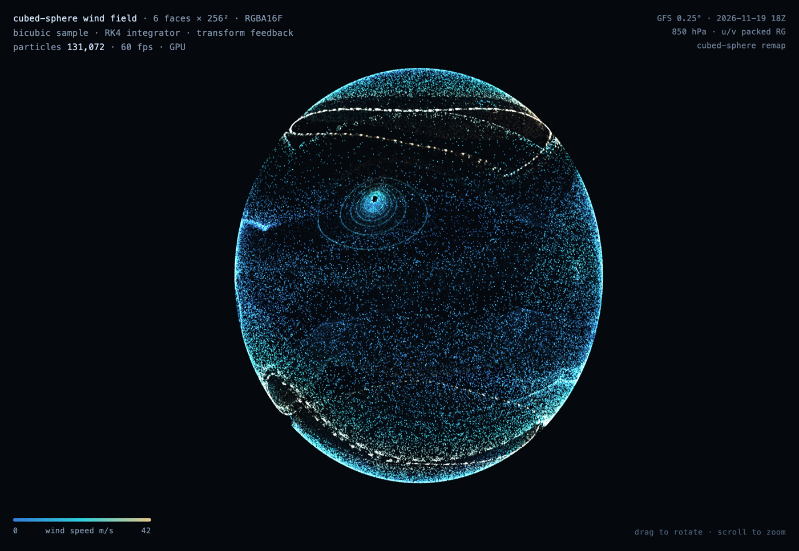

# cubedsphere-windfield

GPU particle advection over a **cubed-sphere** wind field, running in the browser on WebGL2.
Built for synoptic-scale flow visualisation (GFS / ERA5 pressure levels) where a plain
equirectangular grid falls apart near the poles.

**Live demo:** https://nullsssss.github.io/cubedsphere-windfield/



## Why a cubed-sphere

A lat/lon grid has a pole singularity. As meridians converge, east-west texel spacing
collapses to zero and every interpolation kernel smears along the meridian, so particle
trails spiral into the pole in a way that has nothing to do with the actual flow.

A cubed-sphere is six gnomonic projections of the sphere. Angular resolution is close to
uniform everywhere, which is what a bicubic sampler wants. The cost is twelve edges and
eight corners where the sampler has to look at a neighbouring face instead of clamping.

## Pipeline

```
GFS / ERA5 (grib2)
      │  src/data/preprocess.py      spectral→grid, u/v on isobaric levels
      ▼
cubed-sphere faces  6 × N²  (N = 256 by default, 384 for release builds)
      │  RGBA16F, R = u, G = v   (tangent-plane components, not lon/lat)
      ▼
WebGL2 TEXTURE_2D_ARRAY
      │
      ├─ update.vert   RK4 advection, one step per frame, writes back through
      │                transform feedback (interleaved: prev3 | pos3 | seed1)
      │
      └─ draw.vert     bicubic Catmull-Rom lookup (4×4 taps), colour by |v|
                       ▼
                   gl.POINTS, additive blend
```

Velocity is stored **in the face's tangent basis**, not as lon/lat components. That keeps
the value continuous across a face edge (both faces agree on the physical wind vector);
only the basis changes, and the basis is reconstructed analytically in the shader from
`layout(location)` attributes.

## Build

```bash
npm install
npm run dev        # vite, http://localhost:5173
npm run build      # bundles + inlines into a single index.html (this is what Pages serves)
```

`index.html` in the repo root is the inlined build output — that is why it is one file.
The modular source lives in `src/`.

## Runtime knobs

| query param | default | meaning |
|---|---|---|
| `tex`   | 256    | texels per face edge |
| `n`     | 131072 | particle count |
| `frames`| 0      | run N frames then stop (used for headless capture) |
| `export`| –      | `1` dumps the framebuffer to a PNG `` (headless compositing workaround) |

## Known issues

Tracked because they are the interesting part, not because they are cosmetic:

- [ ] **Edge/corner ghost ring incomplete.** The 12 face *edges* wrap correctly through the
      neighbour lookup, the 8 *corners* still clamp. Three faces meet at a corner and the
      4×4 bicubic footprint can reach all three; the index table currently only encodes pairs.
- [ ] **Catmull-Rom overshoot.** The negative lobes push |v| past the local min/max right at
      the jet maximum, which shows up as a ring of accelerated particles. Clamping to the
      neighbourhood min/max in `bicubic()` helps but softens the core.
- [ ] **No mip chain.** Automatic mip generation would blend texels across faces and poison
      the smallest levels. A manual per-face mip build is the fix; not done.
- [ ] **Half-float vs bandwidth.** RGBA32F removes the quantisation banding visible at low
      wind speeds but doubles samplers on mobile. Currently RGBA16F with a clamped kernel.

## Data

`preprocess.py` expects `wgrib2`-decoded GRIB2 on a regular lat/lon grid plus the vertical
coordinate in the header. Vertical interpolation is **linear in log(p)**, not linear in p —
linear-in-p bends the shear between 925 and 850 hPa badly enough to look like a bug.

Sample data is not redistributed here; point `GRIB_IN` at your own GFS pull.

## License

MIT
